# Alexandria - Modern Library Management System 2.0
## Complete Technical Documentation & Visual Reference Guide

---

## 📌 Document Metadata

- **Project Title:** Alexandria Modern Library Management System 2.0
- **Version:** 2.0.0 (Commercial Grade)
- **Primary Language:** Python 3.10+ (Tested on Python 3.14)
- **GUI Engine:** CustomTkinter (SaaS Navy & Teal Theme)
- **Database Engine:** SQLite 3 (Foreign Key Enforcement & Transactional Integrity)
- **Visual Analytics:** Matplotlib (`FigureCanvasTkAgg` integration)
- **Report & Spreadsheet Engine:** OpenPyXL & native CSV
- **Security:** PBKDF2-HMAC-SHA256 Cryptographic Hashing with Salt

---

<a id="index"></a>
## 📑 Table of Contents (Document Index)

1. [Abstract](#abstract)
2. [Executive Overview](#executive-overview)
3. [System Architecture & Technology Stack](#system-architecture)
   - 3.1 [Architectural Diagram](#architectural-diagram)
   - 3.2 [Core Technologies & Dependency Specifications](#technology-stack)
4. [Visual Tour & Interface Showcase (Original Screenshots)](#visual-tour)
   - 4.1 [Staff Authentication & Login Portal](#login-portal)
   - 4.2 [Executive System Dashboard](#system-dashboard)
   - 4.3 [Book Inventory & Catalog](#book-catalog)
   - 4.4 [Book Cataloging Dialog (Modal)](#add-book-dialog)
   - 4.5 [Member Registry & Patron Directory](#member-registry)
   - 4.6 [Patron Registration Dialog (Modal)](#register-member-dialog)
   - 4.7 [Circulation Desk (Issues & Active Loans)](#circulation-desk)
   - 4.8 [Book Checkout & Loan Issuance Dialog (Modal)](#issue-book-dialog)
   - 4.9 [Fine Management & Financial Audit](#fine-management)
   - 4.10 [Reports & Visual Analytics Center](#reports-analytics)
   - 4.11 [System Settings & Database Maintenance](#system-settings)
5. [Database Relational Design & Data Dictionary](#database-design)
   - 5.1 [Entity-Relationship (ER) Diagram](#er-diagram)
   - 5.2 [Schema Specifications & Tables](#schema-specifications)
6. [Circulation Business Logic & Workflows](#circulation-logic)
   - 6.1 [Book Checkout Workflow](#checkout-workflow)
   - 6.2 [Return & Overdue Penalty Settlement Workflow](#return-workflow)
7. [Role-Based Access Control (RBAC) & Security Policies](#rbac-security)
8. [Global Keyboard Shortcuts Cheatsheet](#keyboard-shortcuts)
9. [Installation & Rapid Deployment](#installation)
10. [Verification & Automated Test Suite](#automated-testing)
11. [Alphabetical Topic & Component Index](#alphabetical-index)

---

<a id="abstract"></a>
## 📖 1. Abstract

> **Abstract:**  
> Contemporary academic and institutional libraries encounter significant operational friction when coordinating book circulation, multi-tier patron governance, inventory decrement consistency, overdue penalty accrual, and business intelligence reporting. Traditional desktop library tools frequently rely on deprecated graphical toolkits, lack transactional atomicity, or demand convoluted client-server infrastructure.
> 
> **Alexandria 2.0** resolves these limitations by introducing a high-performance, single-executable desktop Library Management System built with **Python 3**, featuring modern SaaS aesthetics via **CustomTkinter**, relational durability via **SQLite3**, and dynamic data visualization with **Matplotlib**. Designed around a decoupled, Service-Oriented Architecture (SOA), the platform provides real-time catalog filtering, automated overdue fine calculation based on dynamic daily rates, multi-tier member tracking (`Student`, `Faculty`, `Standard`, `Premium`), atomic book stock transitions, and role-based access control (RBAC) safeguarded by salted PBKDF2-HMAC-SHA256 password hashing.
> 
> In addition to operational desk workflows, Alexandria 2.0 incorporates an analytics hub capable of generating formatted Excel (`.xlsx`) spreadsheets and CSV ledgers with a single click, alongside automated database snapshot backup and integrity restoration mechanisms (`PRAGMA integrity_check`). The system demonstrates that modern desktop software can deliver commercial web-application ergonomics while retaining the offline security, zero-latency response, and self-contained deployment advantages of local software architecture.

**Keywords:** `Library Management System (LMS)`, `Python 3`, `CustomTkinter`, `SQLite3`, `Matplotlib`, `Database Integrity`, `Circulation Control`, `Role-Based Access Control (RBAC)`, `Data Visualization`, `Automated Auditing`.

---

<a id="executive-overview"></a>
## 📋 2. Executive Overview

Alexandria 2.0 is an enterprise-grade desktop Library Circulation and Resource Planning platform built with **Python 3**, featuring a modern administrative interface styled with **CustomTkinter**, persistent **SQLite** with strict relational integrity, and embedded **Matplotlib** visual analytics.

The application delivers an end-to-end management experience for librarians and administrative staff, featuring transactional inventory increment/decrement, automated overdue penalty audits, cash/card/UPI fine payments, member management across multiple tiers, receipt issuance, and multi-format data exports (CSV and Microsoft Excel `.xlsx`).

---

<a id="system-architecture"></a>
## 🏗️ 3. System Architecture & Technology Stack

<a id="architectural-diagram"></a>
### 3.1 Architectural Diagram

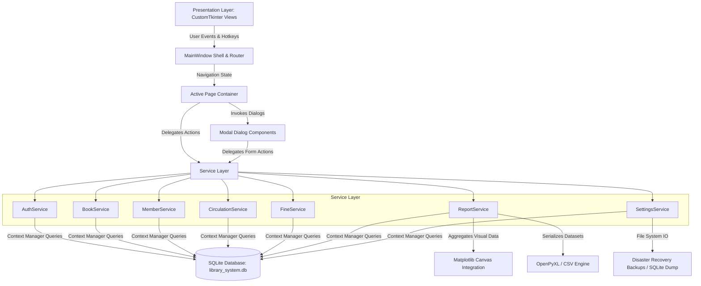

<a id="technology-stack"></a>
### 3.2 Core Technologies & Dependency Specifications

| Component | Technology | Version / Specification | Rationale & Architectural Purpose |
| :--- | :--- | :--- | :--- |
| **Language** | Python | 3.10+ (Tested on 3.14) | Core application runtime, OOP design, and cross-platform compatibility |
| **GUI Framework** | CustomTkinter | 5.2+ | Modern dark navy theme (`#060913`, `#0d1527`), rounded cards, custom widgets |
| **Database** | SQLite3 | Native C-Engine | Embedded zero-configuration ACID database with `PRAGMA foreign_keys = ON` |
| **Analytics Engine** | Matplotlib | 3.8+ | Native `FigureCanvasTkAgg` chart embedding for trends and donut charts |
| **Iconography** | Pillow (PIL) | 10.0+ | Anti-aliased vector icon rendering, dynamic color adaptation, and DPI scaling |
| **Spreadsheets** | openpyxl | 3.1+ | Generation of styled OpenXML Excel (`.xlsx`) workbooks with header formatting |
| **Cryptography** | hashlib / secrets | Standard Library | PBKDF2-HMAC-SHA256 salted hashes with 100,000 iterations for staff credentials |

---

<a id="visual-tour"></a>
## 📸 4. Visual Tour & Interface Showcase (Original Screenshots)

The following original screenshots were captured directly from the active Alexandria 2.0 operational runtime.

---

<a id="login-portal"></a>
### 4.1 Staff Authentication & Login Portal

A secure, centralized access gateway featuring credential verification with PBKDF2 salted hash comparison, password visibility toggling, error alerts, and demo profile access hints.

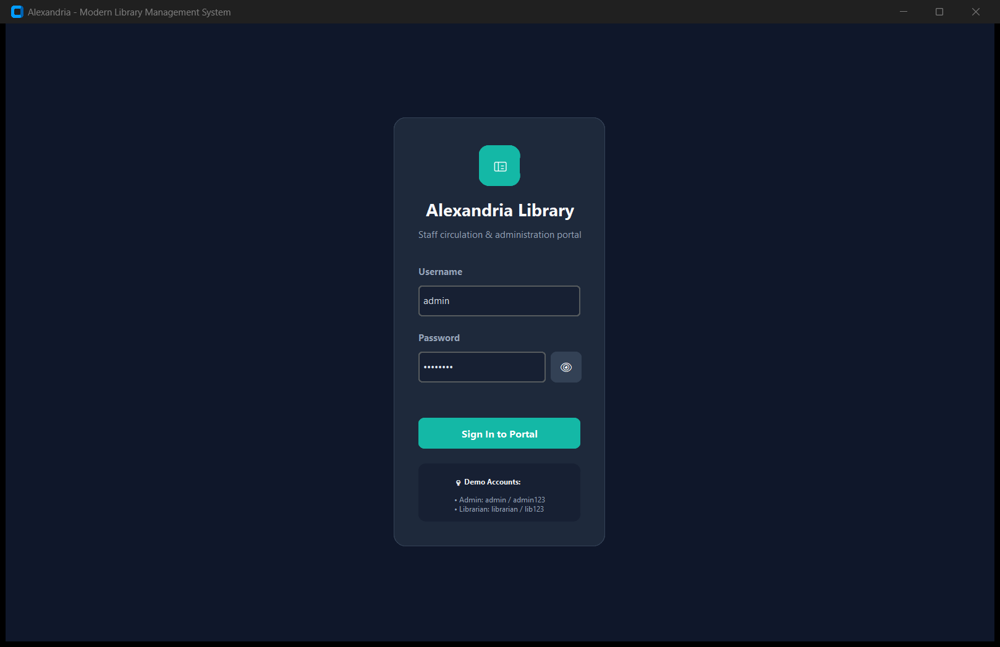

- **Authentication Protocol:** PBKDF2-HMAC-SHA256 with cryptographically generated 16-byte random salts per account.
- **Roles:** Administrator (Full system privileges) and Librarian (Operational daily circulation privileges).
- **Default Test Accounts:**
  - `admin` / `admin123` (Administrator)
  - `librarian` / `lib123` (Librarian)

---

<a id="system-dashboard"></a>
### 4.2 Executive System Dashboard

The executive nerve center of the library, displaying real-time aggregated metrics, live inventory gauges, circulation trends, and quick-action shortcuts.

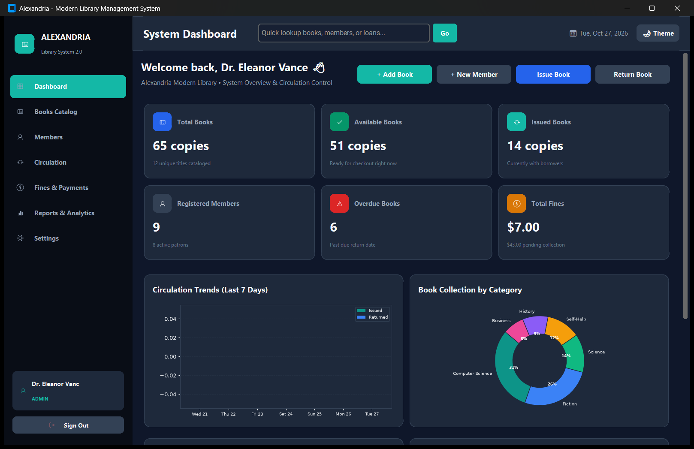

- **Metric Cards (Live KPIs):**
  - **Total Books:** Total collection volume across all cataloged titles and individual copies (e.g., 65 copies across 12 titles).
  - **Available Books:** Instant real-time checkout readiness (e.g., 51 copies available).
  - **Issued Books:** Copies currently in borrower circulation (e.g., 14 active loans).
  - **Registered Patrons:** Total active and registered member profiles.
  - **Overdue Penalties:** Active overdue book count triggering fine computation.
  - **Total Fines:** Historical collected fines vs. pending accruals.
- **Interactive Matplotlib Visualizations:**
  - **7-Day Circulation Flow:** Daily issue vs. return trends dynamically plotted.
  - **Collection Category Breakdown:** Donut chart highlighting collection distribution across Fiction, Science, Computer Science, Business, and History.
- **Quick Action Bar:** Direct triggers for adding books, onboarding patrons, checking out copies, and processing returns.

---

<a id="book-catalog"></a>
### 4.3 Book Inventory & Catalog

A comprehensive search, filter, cataloging, and inventory management screen with instant updates and multi-column sorting.

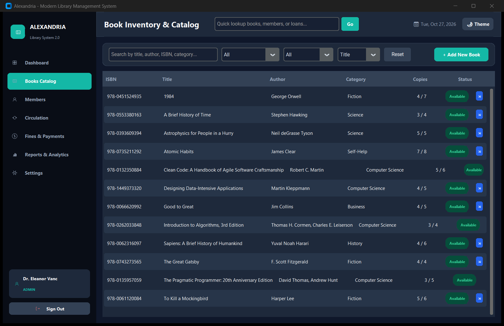

- **Real-Time Search:** Search by ISBN, Title, Author, or Category with debounced instant table filtering.
- **Filtering & Facets:**
  - Category selector (*Computer Science*, *Fiction*, *Science*, *Business*, *History*, *Self-Help*).
  - Availability status filter (*All*, *Available*, *Low Stock*, *Out of Stock*).
  - Sorting criteria (*Title*, *Author*, *Copies Available*, *Category*).
- **Safety Constraints:** Built-in deletion protections prevent removal of book records with active circulating loans.

---

<a id="add-book-dialog"></a>
### 4.4 Book Cataloging Dialog (Modal)

A streamlined modal dialog for entering or updating book metadata, ISBN codes, authors, genres, and stock quantities.

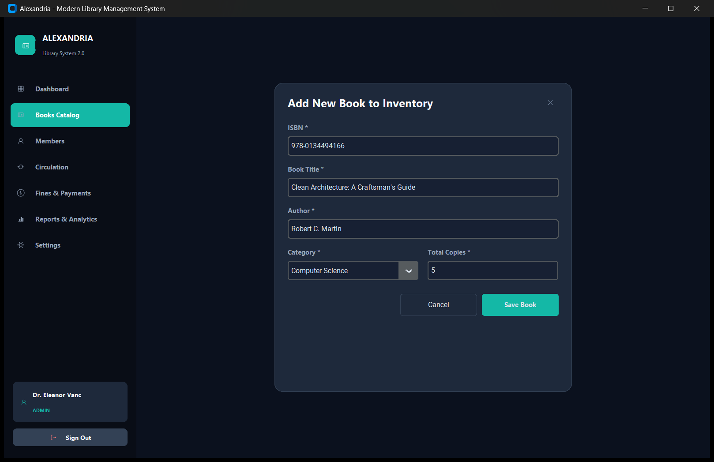

- **Form Fields:** ISBN code, book title, author, category classification dropdown, and initial copy quantity.
- **Transactional Consistency:** New entries immediately synchronize across all database indices and active dashboard metrics.

---

<a id="member-registry"></a>
### 4.5 Member Registry & Patron Directory

A complete directory of all registered library patrons, displaying membership classifications, contact channels, and real-time status indicators.

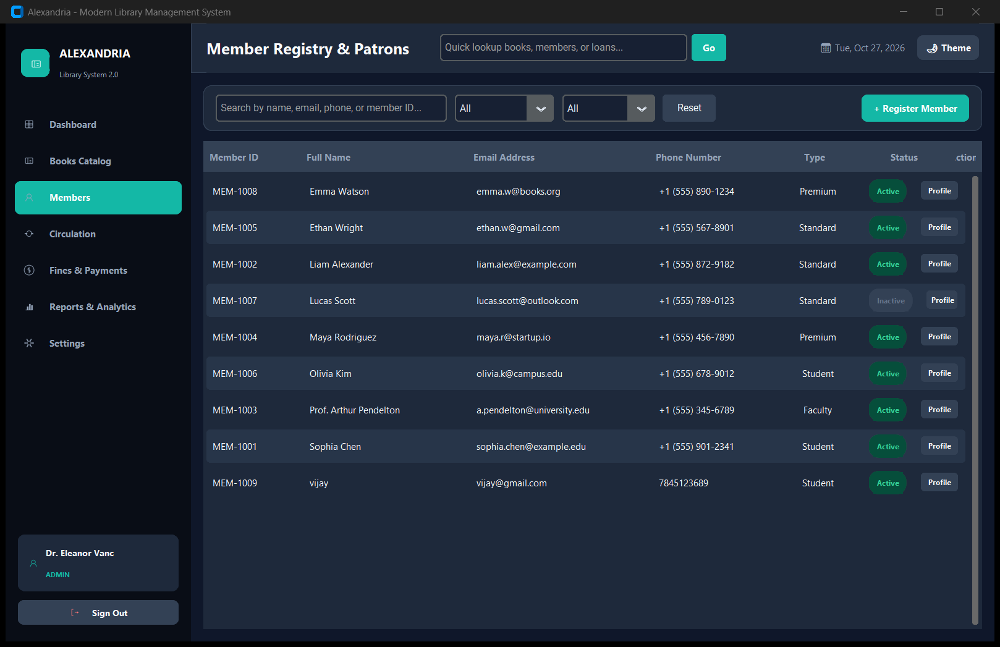

- **Patron Tiers:** Supported categories include `Student`, `Faculty`, `Standard`, and `Premium`.
- **Status Management:** Quick toggling between `Active`, `Inactive`, and `Suspended` states.
- **Patron Profiles:** Detailed profile inspector displaying borrowing history, active loans, and fine settlements.

---

<a id="register-member-dialog"></a>
### 4.6 Patron Registration Dialog (Modal)

A fast onboarding dialog for enrolling students, faculty members, and public borrowers.

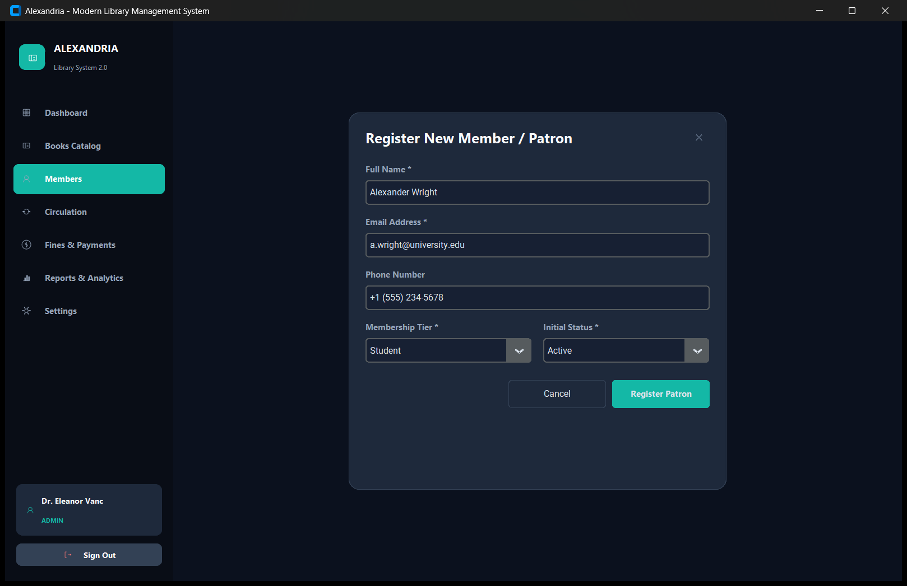

- **Fields:** Full legal name, university/personal email address, contact phone number, initial tier, and operational status.
- **Automatic ID Generation:** Generates unique sequential patron codes (`MEM-XXXX`).

---

<a id="circulation-desk"></a>
### 4.7 Circulation Desk (Issues & Active Loans)

The primary operational desk for issuing books, tracking return deadlines, and auditing overdue loans.

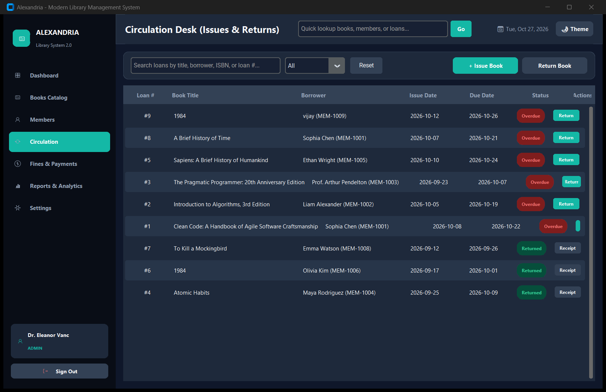

- **Live Loan Tracking:** Displays Loan ID, Book Title, Borrower Name, Issue Date, Due Date, and Status.
- **Overdue Badges:** Dynamic red warning pills highlight loans that have passed their contractual return deadline.
- **One-Click Returns:** Direct `Return` action button to inspect loan duration, compute overdue fines, and update shelf stock.

---

<a id="issue-book-dialog"></a>
### 4.8 Book Checkout & Loan Issuance Dialog (Modal)

A checkout transaction dialog linking available book inventory to verified registered members.

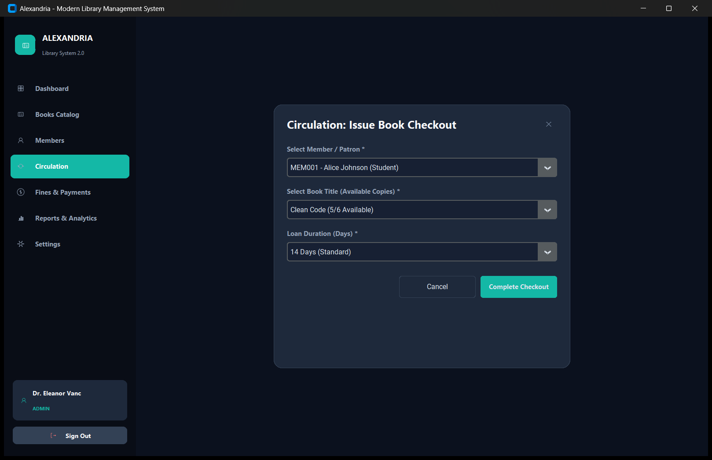

- **Dynamic Selectors:**
  - Member selector with live search and tier display.
  - Book title selector displaying real-time available stock count.
  - Loan duration dropdown (7, 14, 21, or 30 days).
- **Concurrency Guards:** Atomic copy availability decrement protects against double-booking and out-of-stock loans.

---

<a id="fine-management"></a>
### 4.9 Fine Management & Financial Audit

A dedicated revenue and penalty auditing dashboard tracking pending overdue debts and settled payments.

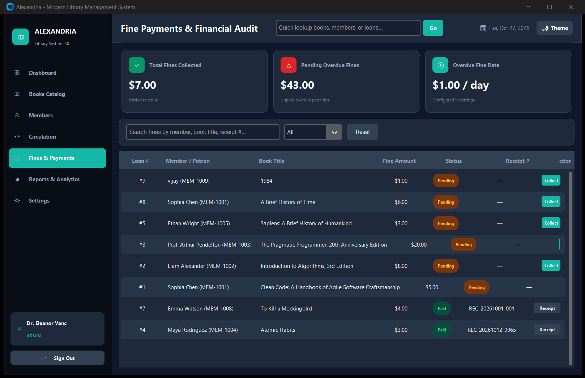

- **Audit Statistics:**
  - **Total Fines Collected:** Settled revenue recorded in system ledger.
  - **Pending Overdue Fines:** Accumulated uncollected penalty balance.
  - **Daily Fine Rate:** Active policy rate (configurable in Settings).
- **Settlement Workflow:** Mark individual overdue penalties as paid via Cash, Card, or UPI with automatic receipt generation.

---

<a id="reports-analytics"></a>
### 4.10 Reports & Visual Analytics Center

Business intelligence and circulation analytics hub with visual breakdown and one-click data export facilities.

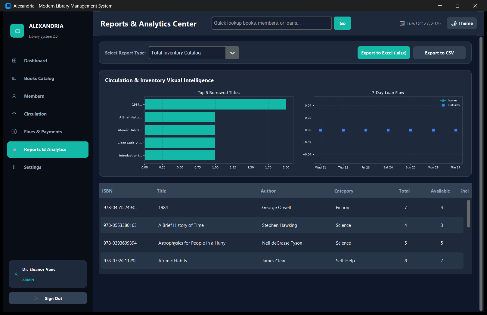

- **Report Datasets:**
  - *Total Inventory Catalog Report*
  - *Most Borrowed Books Ranking*
  - *Most Active Members Ranking*
  - *Overdue Loans Audit Report*
  - *Fines Collection Ledger*
- **Export Formats:**
  - **Microsoft Excel (`.xlsx`):** Formatted spreadsheets with header styling generated via `openpyxl`.
  - **Comma-Separated Values (`.csv`):** Universal data format for external data pipelines.

---

<a id="system-settings"></a>
### 4.11 System Settings & Database Maintenance

Administrative configuration panel for library policies, visual themes, and disaster recovery backup snapshots.

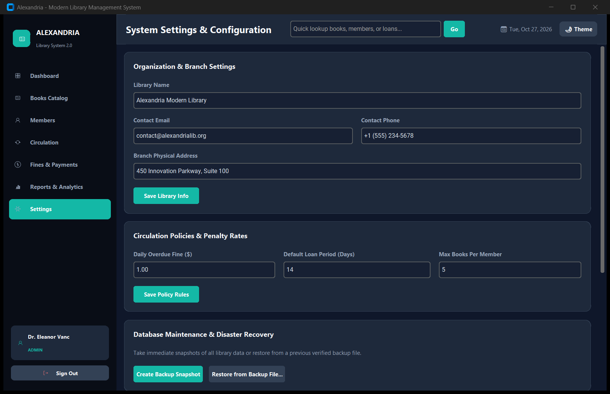

- **Organization & Branch Info:** Library name, administrative email, support phone, and address.
- **Circulation Policies:**
  - Configurable daily overdue fine rate (e.g. `$1.00 / day`).
  - Default loan period in days (e.g. `14 days`).
  - Maximum allowed borrowing limit per patron.
- **Disaster Recovery & Backups:**
  - **Create Backup Snapshot:** Creates a timestamped `.sqlite` snapshot in `backups/`.
  - **Restore from Backup File:** Validates file integrity (`PRAGMA integrity_check`) before safely restoring.

---

<a id="database-design"></a>
## 🗄️ 5. Database Relational Design & Data Dictionary

<a id="er-diagram"></a>
### 5.1 Entity-Relationship (ER) Diagram

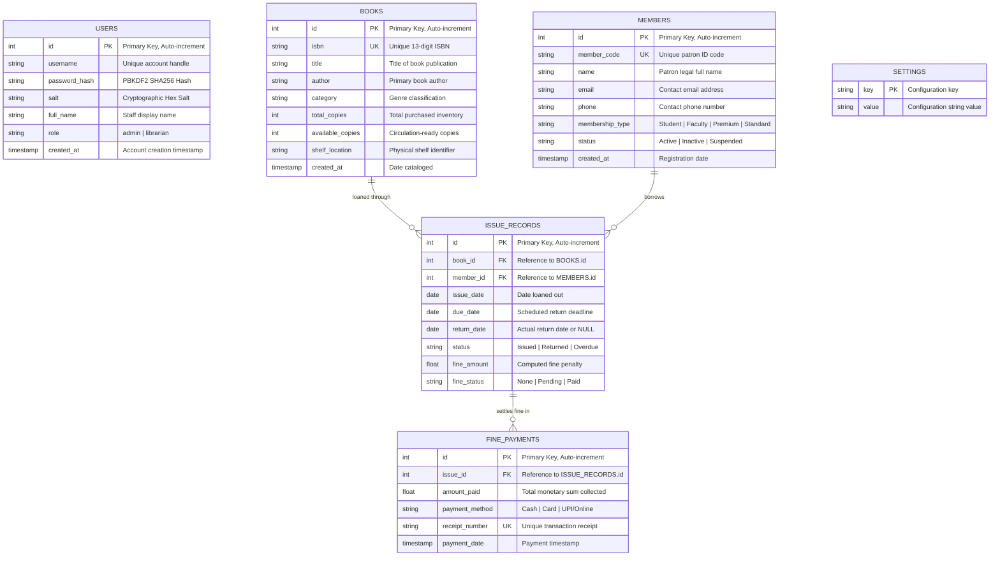

<a id="schema-specifications"></a>
### 5.2 Schema Specifications & Tables

1. **`users` Table:** Stores staff credentials, cryptographic salt tokens, and RBAC privileges (`admin` or `librarian`).
2. **`books` Table:** Houses title metadata, ISBN identifiers, total stock, available stock, and physical shelf coordinates.
3. **`members` Table:** Catalogs patron profiles, membership tiers, contact coordinates, and authorization status.
4. **`issue_records` Table:** Tracks checkout transactions, issue/due/return dates, loan statuses, and accrued penalties.
5. **`fine_payments` Table:** Serves as the official financial ledger documenting settled penalties, payment channels, and receipts.
6. **`settings` Table:** Key-value store holding runtime configurations such as appearance mode, branch info, fine rates, and loan durations.

---

<a id="circulation-logic"></a>
## ⚡ 6. Circulation Business Logic & Workflows

<a id="checkout-workflow"></a>
### 6.1 Book Checkout Workflow


<a id="return-workflow"></a>
### 6.2 Return & Overdue Penalty Settlement Workflow

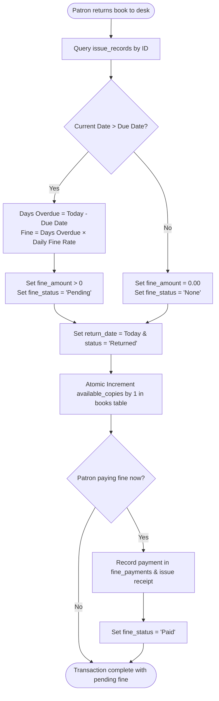

---

<a id="rbac-security"></a>
## 🔐 7. Role-Based Access Control (RBAC) & Security Policies

Alexandria 2.0 implements strict role separation between administrative staff and operating librarians:

| Module / Privilege | Administrator (`admin`) | Librarian (`librarian`) | Security Constraint |
| :--- | :---: | :---: | :--- |
| **System Dashboard** | Full Access | Full Access | Read-only statistical aggregation |
| **Book Catalog (View / Search)** | Full Access | Full Access | Open catalog queries |
| **Book Catalog (Add / Edit / Delete)** | Full Access | Full Access | Safe deletion check against active loans |
| **Member Registry (View / Search)** | Full Access | Full Access | Open patron inspection |
| **Member Registry (Register / Edit)** | Full Access | Full Access | Validation on email, phone, and tier |
| **Circulation Desk (Checkout & Returns)** | Full Access | Full Access | Atomic inventory transactions |
| **Fine Settlement & Receipt Issuance** | Full Access | Full Access | Ledger entry creation |
| **Reports & Excel / CSV Exports** | Full Access | Full Access | Business intelligence data pipelines |
| **Policy Rates & Loan Limits Config** | **Allowed** | *Restricted* | Admin-only policy enforcement |
| **Database Backup & Snapshot Creation** | **Allowed** | *Restricted* | Protected file-system dump |
| **Database Restore & Integrity Recovery** | **Allowed** | *Restricted* | Requires `PRAGMA integrity_check` |
| **User Account Management** | **Allowed** | *Restricted* | Password hashing via PBKDF2 |

---

<a id="keyboard-shortcuts"></a>
## ⌨️ 8. Global Keyboard Shortcuts Cheatsheet

| Shortcut Key | Action Performed | Scope / Target Screen |
| :--- | :--- | :--- |
| `Ctrl + 1` | Switch to **System Dashboard** | Global Navigation |
| `Ctrl + 2` | Switch to **Book Inventory & Catalog** | Global Navigation |
| `Ctrl + 3` | Switch to **Member Registry & Patrons** | Global Navigation |
| `Ctrl + 4` | Switch to **Circulation Desk** | Global Navigation |
| `Ctrl + 5` | Switch to **Fine Payments & Financial Audit** | Global Navigation |
| `Ctrl + 6` | Switch to **Reports & Analytics Center** | Global Navigation |
| `Ctrl + 7` | Switch to **System Settings & Maintenance** | Global Navigation (Admin) |
| `Ctrl + B` | Open **Add New Book** Dialog | Quick Action Dialog |
| `Ctrl + M` | Open **Register Member** Dialog | Quick Action Dialog |
| `Ctrl + I` | Open **Issue Book Checkout** Dialog | Quick Action Dialog |
| `Ctrl + R` | Open **Return Book** Dialog | Quick Action Dialog |

---

<a id="installation"></a>
## 🚀 9. Installation & Rapid Deployment

### 1. Prerequisites
Ensure Python 3.10 or higher is installed:
```bash
python --version
```

### 2. Dependency Installation
Install required packages using pip:
```bash
pip install -r requirements.txt
```

### 3. Launching the Application
Execute the primary entry point:
```bash
python main.py
```

*Note: On initial startup, Alexandria automatically constructs the SQLite database schema and seeds sample books, members, circulation records, and staff administrative accounts.*

---

<a id="automated-testing"></a>
## 🧪 10. Verification & Automated Test Suite

Alexandria comes equipped with an automated unit and integration test suite covering database schema constraints, authentication routines, stock decrement/increment integrity, overdue calculations, and spreadsheet exports:

```bash
python -m unittest tests/test_library_system.py
```

Expected output:
```text
.............
----------------------------------------------------------------------
Ran 13 tests in 0.500s

OK
```

---

<a id="alphabetical-index"></a>
## 🔤 11. Alphabetical Topic & Component Index

- **A**
  - [Abstract](#abstract)
  - [Active Loans](#circulation-desk)
  - [Add Book Dialog](#add-book-dialog)
  - [Administrator Role](#rbac-security)
  - [Architecture (SOA)](#system-architecture)
  - [Automated Tests](#automated-testing)
  - [Availability Filters](#book-catalog)
- **B**
  - [Backup & Disaster Recovery](#system-settings)
  - [Book Catalog](#book-catalog)
  - [Book Checkout Logic](#checkout-workflow)
  - [Business Intelligence](#reports-analytics)
- **C**
  - [Circulation Desk](#circulation-desk)
  - [Circulation Trends Chart](#system-dashboard)
  - [CSV Data Export](#reports-analytics)
  - [CustomTkinter UI Engine](#technology-stack)
- **D**
  - [Dashboard (Executive)](#system-dashboard)
  - [Data Dictionary](#database-design)
  - [Database Schema (SQLite)](#schema-specifications)
- **E**
  - [Entity-Relationship Diagram](#er-diagram)
  - [Excel (.xlsx) Export](#reports-analytics)
- **F**
  - [Faculty Membership Tier](#member-registry)
  - [Fine Calculation Rules](#return-workflow)
  - [Fine Management](#fine-management)
- **H**
  - [Hotkeys & Keyboard Shortcuts](#keyboard-shortcuts)
- **I**
  - [Index (Table of Contents)](#index)
  - [Installation Guide](#installation)
  - [Inventory Catalog](#book-catalog)
  - [Issue Book Dialog](#issue-book-dialog)
  - [ISBN Validation](#add-book-dialog)
- **L**
  - [Librarian Role](#rbac-security)
  - [Login Portal](#login-portal)
- **M**
  - [Matplotlib Visualizations](#system-dashboard)
  - [Member Registry](#member-registry)
  - [Modals & Dialogs](#add-book-dialog)
- **O**
  - [OpenPyXL Engine](#technology-stack)
  - [Overdue Penalty Auditing](#fine-management)
- **P**
  - [Password Hashing (PBKDF2)](#rbac-security)
  - [Payment Methods (Cash, Card, UPI)](#fine-management)
- **R**
  - [Receipt Generation](#fine-management)
  - [Reports Center](#reports-analytics)
  - [Return Book Workflow](#return-workflow)
  - [Role-Based Access Control (RBAC)](#rbac-security)
- **S**
  - [Screenshots Showcase](#visual-tour)
  - [Settings & Policy Configuration](#system-settings)
  - [SQLite Database](#database-design)
  - [Student Membership Tier](#member-registry)
- **T**
  - [Table of Contents](#index)
  - [Testing (Unit & Integration)](#automated-testing)
- **U**
  - [Users Table](#schema-specifications)
- **V**
  - [Visual Tour](#visual-tour)

---
*Alexandria Library Management System 2.0 • Complete Technical Documentation, Formal Abstract & Hyperlinked Index.*
