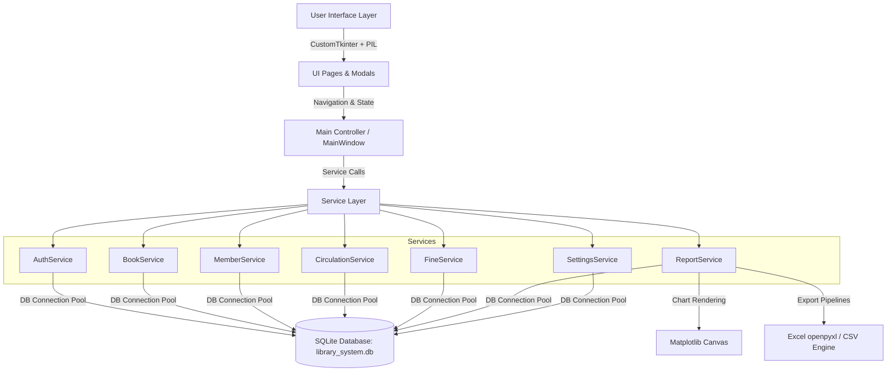
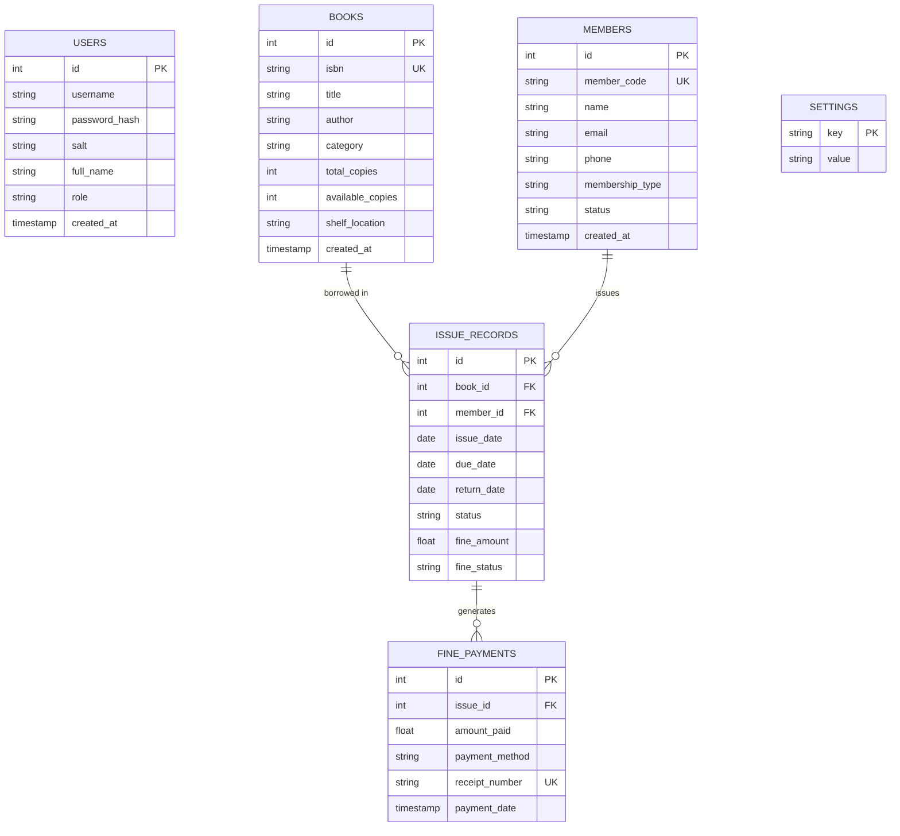
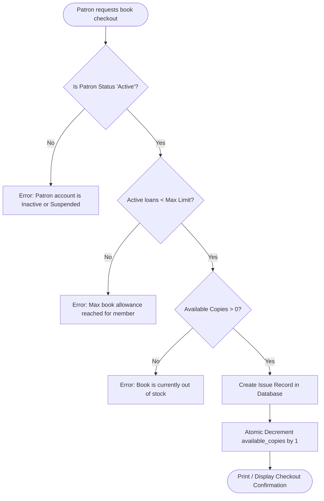

# Alexandria - Modern Library Management System 2.0
## Complete Technical Documentation & Visual Reference Guide

---

## 📋 Executive Overview

**Alexandria 2.0** is an enterprise-grade desktop Library Circulation and Resource Planning platform built with **Python 3**, featuring a modern administrative interface styled with **CustomTkinter**, persistent **SQLite** with strict relational integrity, and embedded **Matplotlib** visual analytics.

The application delivers an end-to-end management experience for librarians and administrative staff, featuring transactional inventory increment/decrement, automated overdue penalty audits, cash/UPI fine payments, member management across multiple tiers, receipt issuance, and multi-format data exports (CSV and Microsoft Excel `.xlsx`).

---

## 📸 Interface Showcase & Visual Tour

Below are original system screenshots captured directly from the live Alexandria 2.0 operational runtime.

---

### 1. Staff Authentication & Login Portal

A secure, centralized access gateway featuring credential verification with PBKDF2 salted hash comparison, password visibility toggling, error alerts, and demo profile access hints.


- **Authentication Protocol:** PBKDF2-HMAC-SHA256 with cryptographically generated 16-byte random salts per account.
- **Roles:** Administrator (Full system privileges) and Librarian (Operational daily circulation privileges).
- **Default Test Accounts:**
  - `admin` / `admin123`
  - `librarian` / `lib123`

---

### 2. Executive System Dashboard

The executive nerve center of the library, displaying real-time aggregated metrics, live inventory gauges, circulation trends, and quick-action shortcuts.


- **Metric Cards (Live KPIs):**
  - **Total Books:** Total collection volume across all cataloged titles and individual copies.
  - **Available Books:** Instant real-time checkout readiness.
  - **Issued Books:** Copies currently in borrower circulation.
  - **Registered Patrons:** Total active and registered member profiles.
  - **Overdue Penalties:** Active overdue book count triggering fine computation.
  - **Total Fines:** Historical collected fines vs. pending accruals.
- **Interactive Matplotlib Visualizations:**
  - **7-Day Circulation Flow:** Daily issue vs. return trends dynamically plotted.
  - **Collection Category Breakdown:** Donut chart highlighting collection distribution across Fiction, Science, Computer Science, Business, and Self-Help.
- **Quick Action Bar:** Direct triggers for adding books, onboarding patrons, checking out copies, and processing returns.

---

### 3. Book Inventory & Catalog

A comprehensive search, filter, cataloging, and inventory management screen with instant updates and multi-column sorting.


- **Real-Time Search:** Search by ISBN, Title, Author, or Category with debounced instant table filtering.
- **Filtering & Facets:**
  - Category selector (e.g. *Computer Science*, *Fiction*, *Science*, *Business*, *History*).
  - Availability status filter (*All*, *Available*, *Low Stock*, *Out of Stock*).
  - Sorting criteria (*Title*, *Author*, *Copies Available*, *Category*).
- **Safety Constraints:** Built-in deletion protections prevent removal of book records with active circulating loans.

---

### 4. Book Cataloging Dialog

A streamlined modal dialog for entering or updating book metadata, ISBN codes, authors, genres, and stock quantities.


- **Form Fields:** ISBN code, book title, author, category classification dropdown, and initial copy quantity.
- **Transactional Consistency:** New entries immediately synchronize across all database indices and active dashboard metrics.

---

### 5. Member Registry & Patron Management

A complete directory of all registered library patrons, displaying membership classifications, contact channels, and real-time status indicators.


- **Patron Tiers:** Supported categories include `Student`, `Faculty`, `Standard`, and `Premium`.
- **Status Management:** Quick toggling between `Active`, `Inactive`, and `Suspended` states.
- **Patron Profiles:** Detailed profile inspector displaying borrowing history, active loans, and fine settlements.

---

### 6. Patron Registration Dialog

A fast onboarding dialog for enrolling students, faculty members, and public borrowers.


- **Fields:** Full legal name, university/personal email address, contact phone number, initial tier, and operational status.
- **Automatic ID Generation:** Generates unique sequential patron codes (`MEM-XXXX`).

---

### 7. Circulation Desk (Issues & Active Loans)

The primary operational desk for issuing books, tracking return deadlines, and auditing overdue loans.


- **Live Loan Tracking:** Displays Loan ID, Book Title, Borrower Name, Issue Date, Due Date, and Status.
- **Overdue Badges:** Dynamic red warning pills highlight loans that have passed their contractual return deadline.
- **One-Click Returns:** Direct `Return` action button to inspect loan duration, compute overdue fines, and update shelf stock.

---

### 8. Book Checkout & Loan Issuance Dialog

A checkout transaction dialog linking available book inventory to verified registered members.


- **Dynamic Selectors:**
  - Member selector with live search and tier display.
  - Book title selector displaying real-time available stock count.
  - Loan duration dropdown (7, 14, 21, or 30 days).
- **Concurrency Guards:** Atomic copy availability decrement protects against double-booking and out-of-stock loans.

---

### 9. Fine Management & Financial Audit

A dedicated revenue and penalty auditing dashboard tracking pending overdue debts and settled payments.


- **Audit Statistics:**
  - **Total Fines Collected:** Settled revenue recorded in system ledger.
  - **Pending Overdue Fines:** Accumulated uncollected penalty balance.
  - **Daily Fine Rate:** Active policy rate (configurable in Settings).
- **Settlement Workflow:** Mark individual overdue penalties as paid via Cash, Card, or UPI with automatic receipt generation.

---

### 10. Reports & Analytics Center

Business intelligence and circulation analytics hub with visual breakdown and one-click data export facilities.


- **Report Datasets:**
  - *Total Inventory Catalog Report*
  - *Most Borrowed Books Ranking*
  - *Most Active Members Ranking*
  - *Overdue Loans Audit Report*
  - *Fines Collection Ledger*
- **Export Formats:**
  - **Microsoft Excel (`.xlsx`):** Formatted spreadsheets with header styling generated via `openpyxl`.
  - **Comma-Separated Values (`.csv`):** Universal data format for external data pipelines.

---

### 11. System Settings & Database Maintenance

Administrative configuration panel for library policies, visual themes, and disaster recovery backup snapshots.


- **Organization & Branch Info:** Library name, administrative email, support phone, and address.
- **Circulation Policies:**
  - Configurable daily overdue fine rate (e.g. `$1.00 / day`).
  - Default loan period in days (e.g. `14 days`).
  - Maximum allowed borrowing limit per patron.
- **Disaster Recovery & Backups:**
  - **Create Backup Snapshot:** Creates a timestamped `.sqlite` snapshot in `backups/`.
  - **Restore from Backup File:** Validates file integrity (`PRAGMA integrity_check`) before safely restoring.

---

## 🏗️ Architecture & Technology Stack



### Core Technologies
| Component | Technology | Version / Specification |
| :--- | :--- | :--- |
| **Language** | Python | 3.10+ (Tested on 3.14) |
| **GUI Framework** | CustomTkinter | 5.2+ (Dark navy theme with teal accents) |
| **Database** | SQLite3 | Native with `PRAGMA foreign_keys = ON` |
| **Analytics Engine** | Matplotlib | 3.8+ (`FigureCanvasTkAgg` integration) |
| **Iconography** | Pillow (PIL) | Vector icon rendering & dynamic scaling |
| **Spreadsheets** | openpyxl | OpenXML Excel workbook generator |
| **Security** | hashlib / secrets | PBKDF2-HMAC-SHA256 salted hashes |

---

## 🗄️ Database Relational Design

The system is underpinned by 6 normalized tables with foreign key cascades and transactional consistency:



---

## ⚡ Circulation Business Logic

### Checkout Flowchart


---

## ⌨️ Global Keyboard Shortcuts

| Shortcut Key | Action Performed |
| :--- | :--- |
| `Ctrl + 1` | Switch to **System Dashboard** |
| `Ctrl + 2` | Switch to **Book Inventory & Catalog** |
| `Ctrl + 3` | Switch to **Member Registry & Patrons** |
| `Ctrl + 4` | Switch to **Circulation Desk** |
| `Ctrl + 5` | Switch to **Fine Payments & Financial Audit** |
| `Ctrl + 6` | Switch to **Reports & Analytics Center** |
| `Ctrl + 7` | Switch to **System Settings & Maintenance** |
| `Ctrl + B` | Open **Add New Book** Dialog |
| `Ctrl + M` | Open **Register Member** Dialog |
| `Ctrl + I` | Open **Issue Book Checkout** Dialog |
| `Ctrl + R` | Open **Return Book** Dialog |

---

## 🚀 Installation & Rapid Deployment

### 1. Prerequisites
- Python 3.10, 3.11, 3.12, 3.13, or 3.14.

### 2. Dependency Installation
```bash
pip install -r requirements.txt
```

### 3. Launching Application
```bash
python main.py
```

*Note: On first startup, Alexandria automatically initializes the database schema and seeds sample books, members, circulation records, and administrative accounts.*

---

## 🧪 Verification & Automated Testing

The project includes an automated test suite verifying database foreign keys, stock atomic decrement/increment, overdue calculation routines, authentication validation, and report exports:

```bash
python -m unittest tests/test_library_system.py
```

Expected result:
```text
Ran 13 tests in 0.98s
OK
```

---
*Alexandria Library Management System 2.0 • Generated Technical Documentation with Original UI Captures.*
